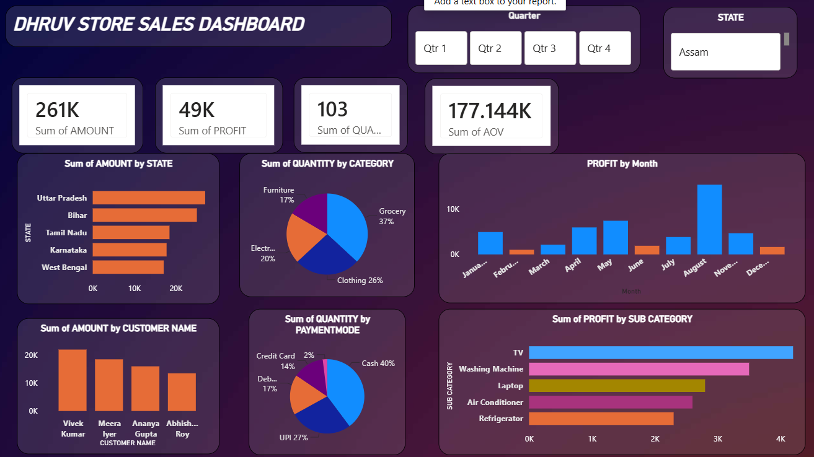

# 📊 Dhruv Store Sales Dashboard

A professional **Power BI Sales Dashboard** designed to analyze store sales performance, profit, quantity, customer behavior, and product categories. This project transforms sales data into meaningful business insights through interactive charts and visualizations.

## 📸 Dashboard Preview

## 📌 Project Overview

The **Dhruv Store Sales Dashboard** is an interactive business intelligence project developed using Microsoft Power BI.

The main objective of this project is to analyze store sales data and understand overall business performance. It provides a clear view of sales, profit, product categories, customer purchasing behavior, and payment preferences.

The dashboard helps identify high-performing states, profitable products, monthly sales trends, and customer contributions. Interactive filters allow users to explore data based on different quarters and states.

## 🎯 Key Performance Indicators (KPIs)

The dashboard displays important business metrics to understand overall sales performance.

- **Total Amount: 261K** – Represents the total sales amount generated by the store.
- **Total Profit: 49K** – Shows the profit generated from sales transactions.
- **Total Quantity: 103** – Displays the quantity metric shown in the dashboard.
- **AOV: 177.144K** – Represents the displayed AOV metric.

## 📈 Dashboard Features

**1. Sales Analysis by State**

Analyzes sales performance across different states to identify regions contributing the most to total revenue.

**2. Quantity Analysis by Category**

Displays the contribution of different product categories, including Grocery, Clothing, Electronics, and Furniture.

**3. Monthly Profit Analysis**

Shows month-wise profit trends to understand business performance and identify months with higher profit contributions.

**4. Customer-wise Sales Analysis**

Compares sales generated by different customers to understand customer contributions to overall business revenue.

**5. Payment Mode Analysis**

Analyzes customer payment preferences, including Cash, UPI, Debit Card, and Credit Card.

**6. Profit Analysis by Sub-Category**

Compares profit generated by different product sub-categories such as TV, Washing Machine, Laptop, Air Conditioner, and Refrigerator.

**7. Interactive Filters**

Provides Quarter and State filters to explore and analyze specific portions of the sales data.

## 🛠️ Tools & Technologies

- **Microsoft Power BI:** Used to create the interactive dashboard and visual reports.
- **Data Visualization:** Used to represent business data through charts, graphs, and KPI cards.
- **Data Analysis:** Used to identify patterns, trends, and business performance.
- **Data Cleaning:** Used to prepare and organize data for analysis.
- **Interactive Dashboards:** Used to make data exploration easier through filters and visual interactions.

## 💡 Key Insights

Based on the dashboard analysis:

- Uttar Pradesh has the highest sales among the displayed states.
- Grocery contributes the highest quantity share at 37%.
- Cash is the most preferred payment method, contributing 40%.
- TV generates the highest profit among the displayed sub-categories.
- August shows a significant increase in monthly profit compared to other months.
- Customer-wise analysis helps identify customers contributing significantly to store sales.

## 🎯 Project Objective

The objective of this project is to develop an interactive sales reporting solution that helps businesses monitor performance, understand customer behavior, identify profitable product categories, and make better data-driven decisions.

## 👨‍💻 Author

**Dhruv Raheja**

Aspiring Data Analyst | Python | Machine Learning | Data Science | Data Analysis | Power BI

📧 Email: dhruvvvraheja27@gmail.com

---

⭐ If you find this project interesting, feel free to explore the dashboard and its features.

**Thank you for visiting my project!**
